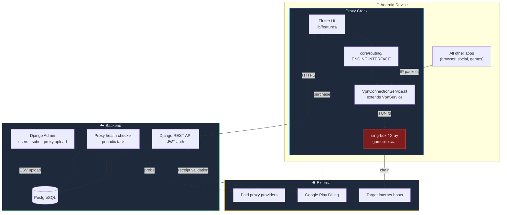
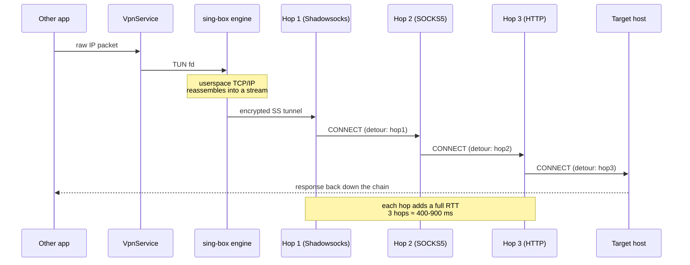
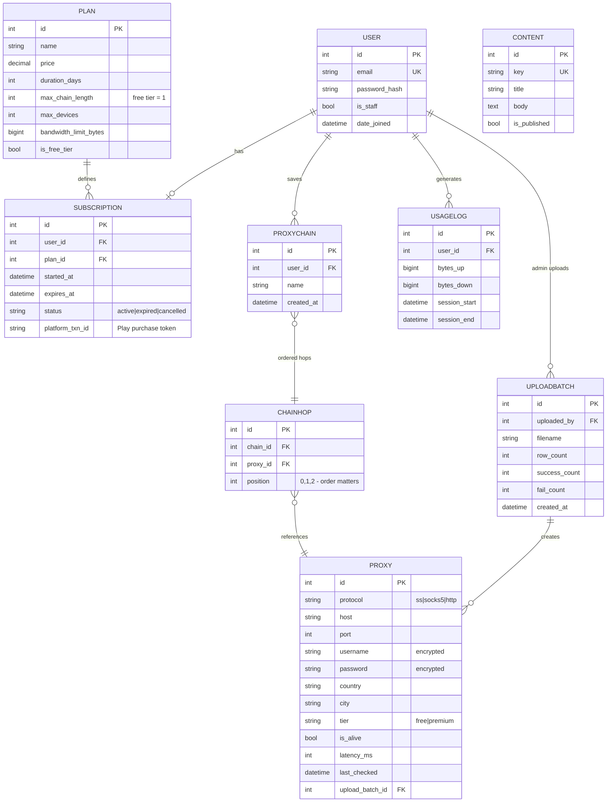
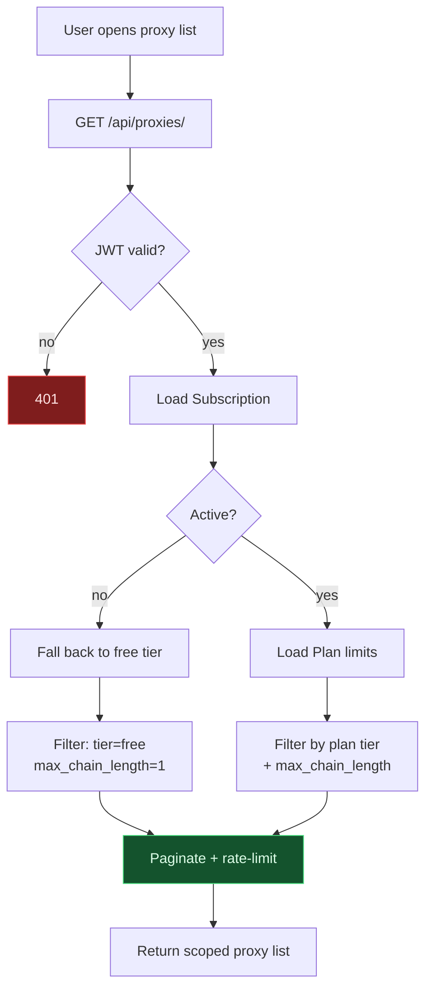
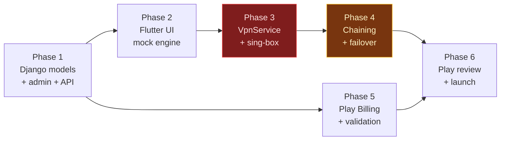

# Proxy Crack — System Graph

Component relationships, data flow, and entity model. Keep in sync with `architecture.md`.

**Last updated:** 2026-10-15

---

## 1. Component graph



> The red node is the highest-risk component — see `architecture.md` §1.

---

## 2. Traffic path (the core mechanism)



**Failure mode:** any hop dying kills the chain. Per-hop health checks and failover are
required, not optional.

---

## 3. Data model



---

## 4. Entitlement flow — the thing that must not be client-side



**Rule:** the server decides what a user may see. The client never filters for entitlement —
it only renders what it is given. Chain length is re-validated on `POST /api/chains/`.

---

## 5. Repository layout

```
D:\project\Proxy\
├── Project\              decisions + design (this folder)
│   ├── architecture.md   system design
│   ├── memory.md         decisions, state, gotchas
│   └── graph.md          this file
├── Pre-Flight\           environment setup checklist + install log
├── app\                  Flutter mobile app
│   ├── lib\
│   │   ├── core\routing\     engine interface (swap-proof)
│   │   ├── features\         proxies · subscription · connection
│   │   └── data\             API client, cache
│   └── android\app\src\main\kotlin\
│       ├── VpnConnectionService.kt
│       └── SingBoxBridge.kt
└── backend\              Django 5 + DRF
    ├── .venv\
    ├── api\              DRF serializers, viewsets
    ├── proxies\          Proxy, UploadBatch, health checks
    ├── billing\          Plan, Subscription, Play validation
    └── core\             settings, admin customisation
```

---

## 6. Build dependency order



Phases 1, 2 and 5 are conventional. **Phase 3 is the risk** and gates everything after it.
